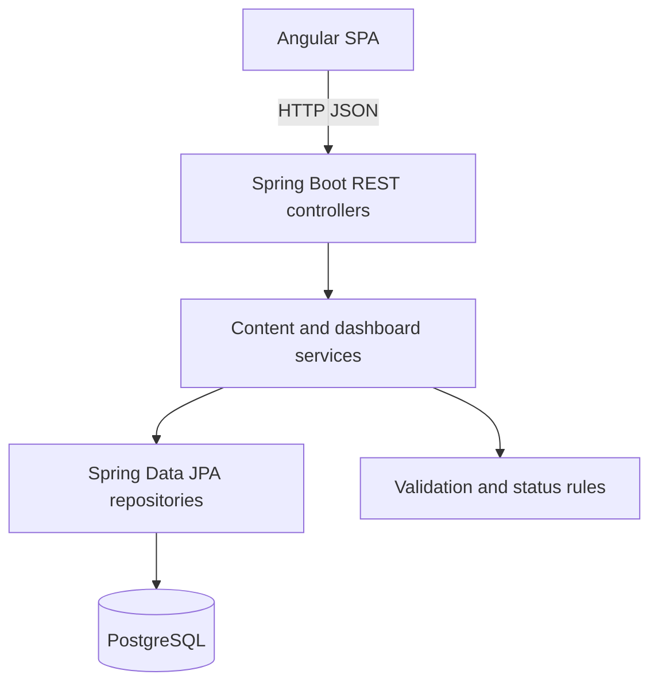

# CreatorWorkflow — MVP Architecture

## Purpose
A personal-first content workflow application for creators who publish short-form content on TikTok, YouTube Shorts, and Instagram. Plan ideas, manage drafts, schedule intended publishing dates, record publication details, and enter performance metrics manually.

**Important:** MVP scheduling means planning a date/time, **not** automatically posting to social platforms.

## Scope
### In scope
- Create, list, edit, delete and filter content items.
- Assign one platform to each item: TIKTOK, YOUTUBE_SHORTS or INSTAGRAM_REELS.
- Maintain a lifecycle: IDEA → DRAFT → READY → SCHEDULED → PUBLISHED (or ARCHIVED).
- Record an optional scheduled timestamp and publish URL.
- Enter manual metrics per published item: views, likes, comments, shares.
- Dashboard: counts by status, upcoming scheduled items, total views and top posts.
- Local development through Docker Compose with seeded sample data.

### Out of scope
Platform OAuth, automatic publishing, fetching analytics from platform APIs, media upload/rendering, multi-user collaboration, AI content generation, notification delivery, production hosting and billing.

## Technology
- Frontend: Angular (standalone components), TypeScript; basic responsive UI.
- Backend: Java 21, Spring Boot 3, Spring Web, Spring Data JPA, Bean Validation.
- Persistence: PostgreSQL 16 with Flyway SQL migrations.
- Local infrastructure: Docker Compose for db and optionally application services.
- Testing: JUnit 5 / Spring Boot integration tests and Angular component/unit tests.
- API: REST JSON under `/api/v1`; dates in ISO-8601 UTC, stored as timestamps with timezone.

## Logical architecture


## Data model
### content_items
- id UUID primary key
- title VARCHAR(160) NOT NULL
- description TEXT nullable
- platform VARCHAR(32) NOT NULL
- status VARCHAR(24) NOT NULL DEFAULT 'IDEA'
- scheduled_at TIMESTAMPTZ nullable
- published_at TIMESTAMPTZ nullable
- published_url TEXT nullable
- created_at TIMESTAMPTZ NOT NULL
- updated_at TIMESTAMPTZ NOT NULL

### content_metrics
- id UUID primary key
- content_id UUID NOT NULL UNIQUE references content_items(id) ON DELETE CASCADE
- views BIGINT NOT NULL DEFAULT 0
- likes BIGINT NOT NULL DEFAULT 0
- comments BIGINT NOT NULL DEFAULT 0
- shares BIGINT NOT NULL DEFAULT 0
- recorded_at TIMESTAMPTZ NOT NULL

One content item targets one platform in the MVP. A cross-post is represented by a separate content item, avoiding ambiguous platform-specific metrics.

## Key rules
- Metrics are allowed only for PUBLISHED content.
- Metrics must be non-negative.
- SCHEDULED requires scheduled_at; PUBLISHED requires published_at.
- published_url is optional for MVP.
- Dates are submitted and returned as UTC instants; frontend formats in the browser's local timezone.
- Editing an item can move statuses forward or backward except ARCHIVED, which is restored explicitly; enforce allowed transitions in the service layer.
- The backend validates inputs and returns structured 400/404 responses.

## Proposed endpoints
- `GET /api/v1/content?platform=&status=&search=&page=&size=`
- `POST /api/v1/content`
- `GET /api/v1/content/{id}`
- `PUT /api/v1/content/{id}`
- `DELETE /api/v1/content/{id}`
- `PUT /api/v1/content/{id}/metrics` (upsert manual metrics, published only)
- `GET /api/v1/dashboard/summary`
- `GET /api/v1/dashboard/upcoming` (future scheduled items)

Responses use DTOs, not JPA entities. Pagination defaults to 20 items and caps at 100.

## Suggested repository layout
```
creator-workflow/
  backend/
    src/main/java/.../content/
    src/main/java/.../dashboard/
    src/main/resources/db/migration/
    src/test/
  frontend/
    src/app/features/content/
    src/app/features/dashboard/
    src/app/core/api/
  docs/
    architecture.md
    implementation-plan.md
    api-examples.md
  compose.yaml
  README.md
```

## Security and operational notes
- MVP is single-user/local only; no public deployment without authentication and CORS restrictions.
- Never commit credentials. Use environment variables and provide a sample .env.example.
- If publicly deployed later, add user ownership, authorization, rate limiting, HTTPS and migrations/backup strategy.
- Keep API response error details useful but do not leak stack traces.
